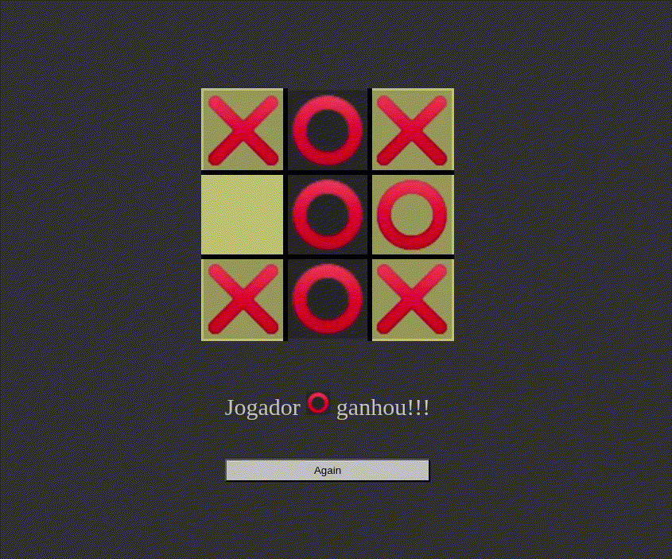
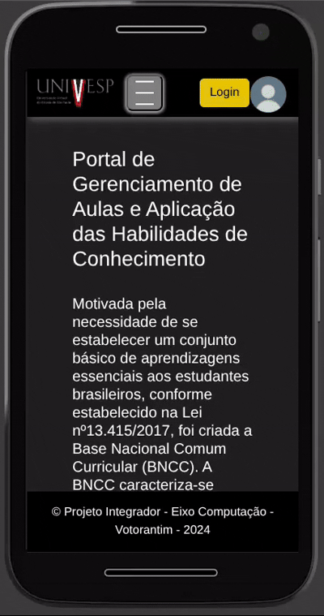
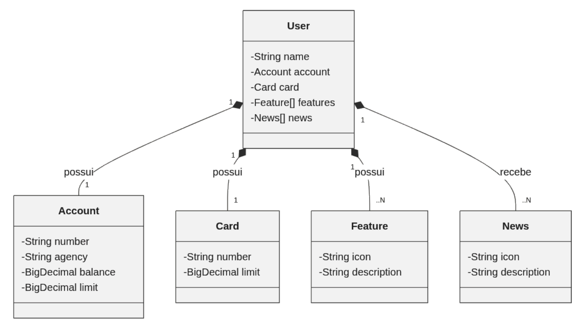
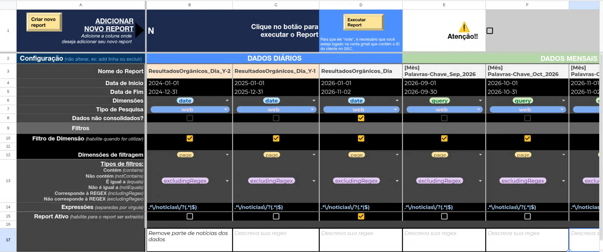
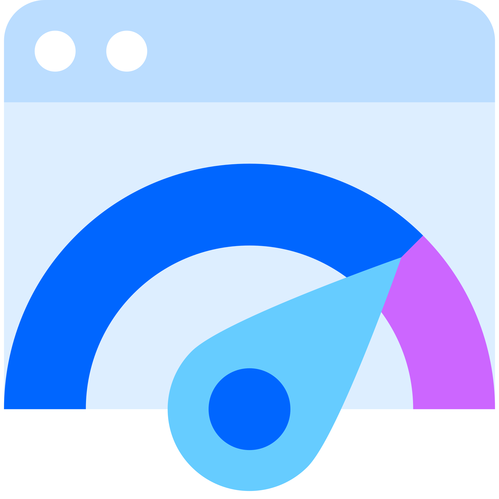
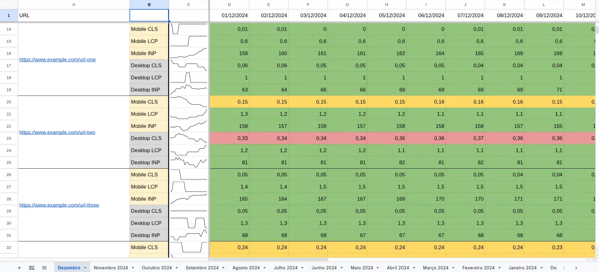
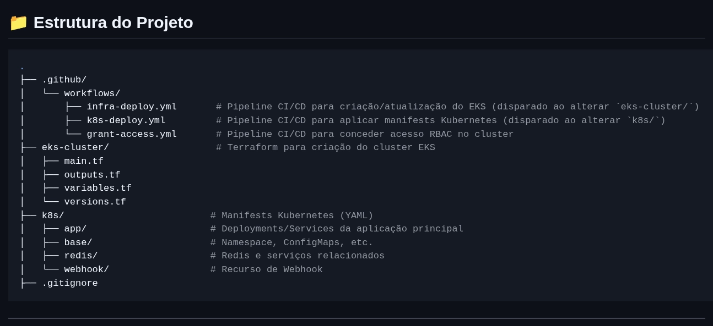
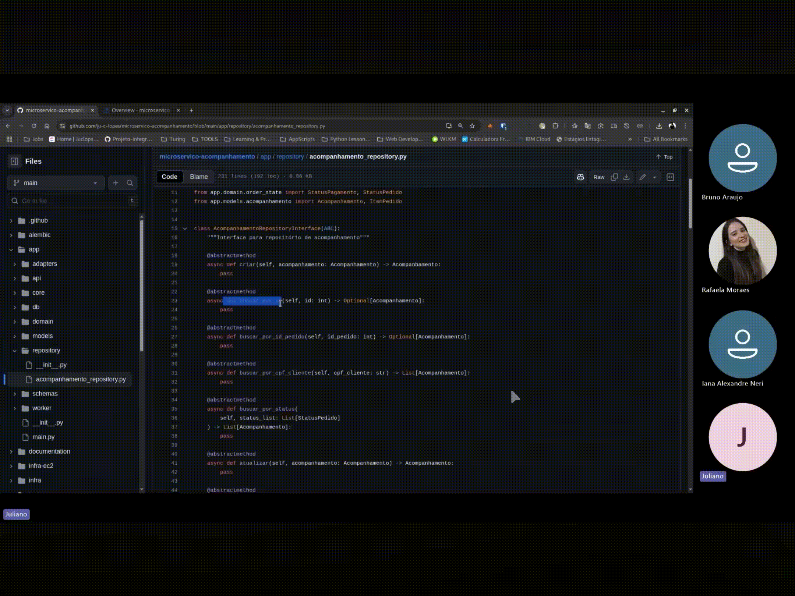
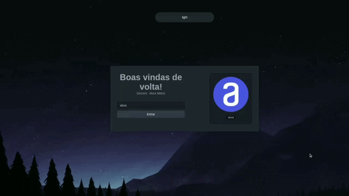
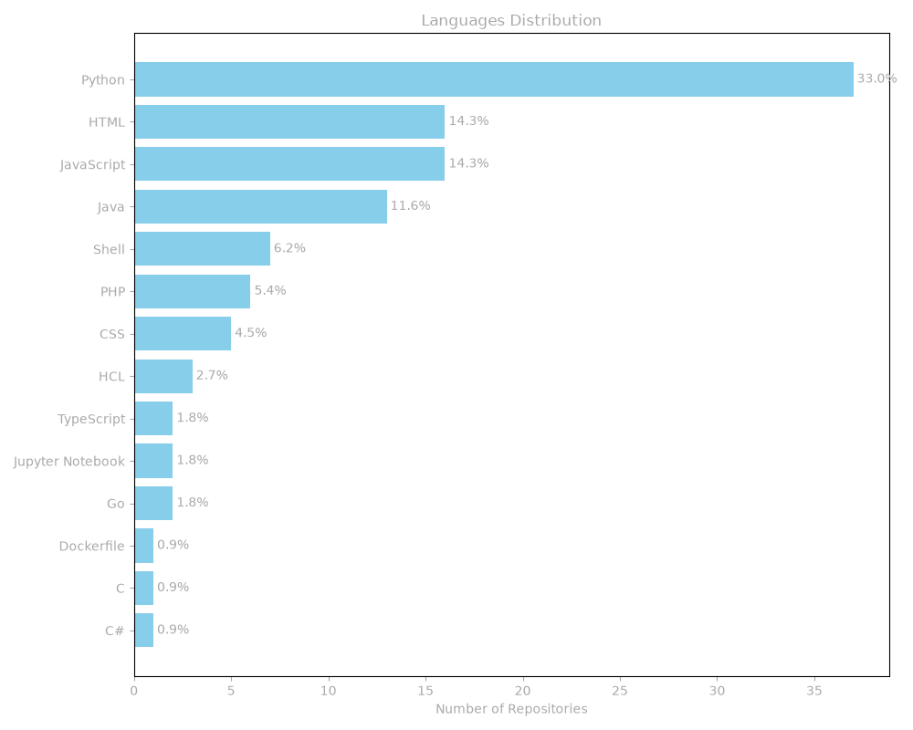

# Hello  !

[ :us: English Version](#)

Hi, :raising_hand_man:, I'm **_Juliano Lopes_**, a backend developer passionate about infrastructure and automation.

As I kept learning and diving deeper into the programming world, I had the opportunity to work in **technical SEO**, where I learned to see systems not just as software, but as **living ecosystems of performance and experience(UX)**.

Today, I bring that same mindset into building **APIs, CI/CD pipelines, and cloud architectures**, solutions that are scalable, testable, and efficient from development to deployment.

> 💡 “From optimizing websites to optimizing systems — the essence remains the same: delivering value through performance.”

[ :brazil: Versão em Português](#)

Olá, :raising_hand_man:, me chamo **_Juliano Lopes_**, sou desenvolvedor backend e entusiasta de infraestrutura e automação.

Conforme fui aprendendo e mergulhando cada vez mais no universo da programação, tive a oportunidade de atuar no **SEO técnico**, onde aprendi a enxergar sistemas não apenas como código, mas como **ecossistemas de performance e experiência(UX)**.

Hoje, canalizo essa visão em projetos que unem **backend, pipelines CI/CD e cloud infrastructure**, construindo soluções escaláveis, testáveis e bem orquestradas — da aplicação ao deploy.

> 💡 “Da otimização de páginas à otimização de sistemas — a essência continua sendo entregar valor com eficiência.”

## :mortar_board: Education

- :school: Bachelor in Information Technology at [Univesp](https://univesp.br/) (2020 - 2024).
- :books: Postgraduate in Software Architecture at [Fiap](https://postech.fiap.com.br/) (2024 - 2025).

---

<!--STATS-START-->
## 📊 **GitHub Stats**
- 👥 Followers: **`92`**
- 📦 Public Repositories: **`135`**
- 🌟 Earned stars: **`6`**
- 💬 Most used languages: **`Python, JavaScript, HTML`**
- 🕓 Latest update: **`2026-11-03 11:20 America/Sao_Paulo`**
<!--STATS-END-->

---

## &nbsp;&nbsp;&nbsp; Relevant repositories

### :anchor: **APIs & Back-end**

|  |  |  |
| -- | -- | -- |
| [Juclops' TechXperience](https://techxperience.blog)        | A _**CMS platform**_ built in Django that host _my personal blog_ in my homelab that creates blog posts with _optimized and maintenance SEO definitions_.  This project became a private repository, deployed online at [https://techxperience.blog](https://techxperience.blog) |  |
| [Jogo da Velha Multiplayer](https://jogo-da-velha.fun)    &nbsp;&nbsp;&nbsp;&nbsp;&nbsp; | A game with rules managed in the backend whose allow matches among two players, with in-memory game state, don't keeping nothing saved in databases, only with socket\.io communication, deployed at Render and online at [https://jogo-da-velha.fun](https://jogo-da-velha.fun).  Try it with a partner! |  |
| [Aplicação  ](https://github.com/ju-c-lopes/aplicacao-django) | A _**full-stack Django application**_ made by the Univesp classmates, featuring CI/CD, containerization, and automated testing. This is a web application for managing classes taught according to the requirements of the _Educational São Paulo's Curriculum Evaluation_ The project can be accessed in this link below: [https://aplicacao-django.fly.dev/](https://aplicacao-django.fly.dev/) |  |
| [Santander BootCamp](https://github.com/ju-c-lopes/santander-bootcamp-dio) [DIO](https://web.dio.me/)   | A challenge for create a **Swagger** documentation to save user data in database |  |

### :game_die: Data Pipelines

|  |  |  |
| -- | -- | -- |
| [Data Extractor Pipeline for Google Search Console](#)    &nbsp;&nbsp;&nbsp;&nbsp;&nbsp;    | A reusable automated data extractor that uses Google Search Console API at Apps Script and feed several spreadsheets to deliver SEO reports.  The UI is managed by user on a spreadsheet where they set extract definitions. |  |
| [Daily Core Web Vitals Metrics Collector](#)    &nbsp;&nbsp;&nbsp;&nbsp;&nbsp; | An automation to colletc Core Web Vitals metrics, monitoring their performances, using PageSpeed Insights API and feeding the spreadsheet daily, creating new tabs when each month ends, keeping historical behavior.           |  |

### :building_construction: Infrastructure & DevOps

|  |  |  |
| -- | -- | -- |
| [Kubernetes Cluster with Terraform (EKS)]()      | CI/CD pipeline to deploy an EKS cluster into AWS using Terraform.  This project was an academic project built by team classmates in a Tech Challenge Evaluation at FIAP |  |

### :construction: Architecture & microservices (Tech Challenge)

|  |  |  |
| -- | -- | -- |
| [Microserviço Acompanhamento](https://github.com/ju-c-lopes/microservico-acompanhamento) &nbsp;&nbsp;&nbsp;&nbsp; | An academic project of Post-graduate, Tech-challenge, that was a _lanchonete_ platform, where this microservice is the part of authentication of the projetc.  The whole project can be accessed here: [Entrega final - Fase 4 Tech Challenge](https://drive.google.com/file/d/1ZKRrSVNt9pM5mLUV-pzPnzAVlE3vnF4L/view?usp=sharing) |  |

### :hammer_and_wrench: Studies & Prototypes

|  |  |  |
| -- | -- | -- |
| [AluraCord - Alura Imersion (2022)](https://github.com/ju-c-lopes/aluracord-juclops)    | Alura Imersion week: 5 classes that practiced a chat application web made in React/Next.js |  |

### :art: Creative & Technical Content Studies

|  |  |  |
| -- | -- | -- |
| :studio_microphone: [RockTech podcast - Código Pesado](https://github.com/ju-c-lopes/podcast-codigo-pesado) | [DIO](https://www.dio.me) Challenge to practice AI project creations  For this project we were challenged to create a podcast  Tools: &nbsp;&nbsp;⦁ Leonardo AI &nbsp;&nbsp;⦁ ElevenLabs &nbsp;&nbsp;⦁ CapCut &nbsp;&nbsp;⦁ ChatGPT |  |
| Mini ebook - [Entre Portas e Túneis](https://github.com/ju-c-lopes/ebook-ssh): Além dos horizontes do SSH Login | [DIO](https://www.dio.me) Challenge to practice AI project creations  For this project we were challenged to create a mini-ebook  Tools: &nbsp;&nbsp;⦁ ChatGPT &nbsp;&nbsp;⦁ Google Slides &nbsp;&nbsp;⦁ DALL.E 3 |  |

## 📊 Language Distribution

---

  

